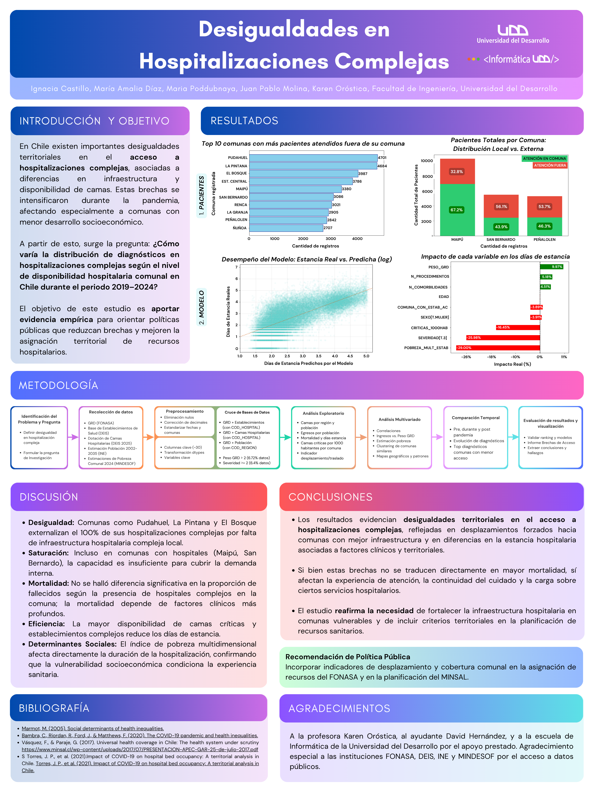

# Desigualdad en Salud Chilena: un estudio enfocado en las comunas y su acceso a hospitalizaciones complejas

**Integrantes:** Juan Pablo Molina, Maria Poddubnaya, María Amalia Díaz, Ignacia Castillo  
**Universidad del Desarrollo**

## Descripción del proyecto

Investigación sobre las desigualdades territoriales en el acceso a hospitalizaciones complejas en Chile durante el período 2019–2024. El trabajo integra fuentes públicas sobre egresos hospitalarios, establecimientos de salud, disponibilidad de camas, población y pobreza comunal para estudiar las diferencias entre comunas y su relación con la atención hospitalaria.

## Resultados

El póster final resume la metodología, las visualizaciones y las conclusiones del estudio.

**[Ver el póster completo en PDF](assets/Poster.pdf)**

### Principales hallazgos

- En los registros analizados, comunas como **Pudahuel, La Pintana y El Bosque** presentaron sus hospitalizaciones complejas fuera de su propia comuna, según el análisis del estudio.
- Se observaron diferencias territoriales en la distribución de pacientes y en la duración de las hospitalizaciones, asociadas a factores clínicos, infraestructura y condiciones socioeconómicas.
- El estudio no encontró una diferencia significativa en la proporción de fallecidos atribuible únicamente a la presencia de hospitales complejos en la comuna.
- Como recomendación, se propone considerar indicadores de desplazamiento y cobertura comunal en la planificación de recursos sanitarios.

## Metodología

El trabajo consideró las siguientes etapas, desarrolladas por el equipo:

1. **Recolección de datos:** GRD de FONASA, establecimientos y camas hospitalarias de DEIS/MINSAL, proyecciones de población del INE y estimaciones de pobreza comunal.
2. **Preprocesamiento:** tratamiento de valores nulos, corrección de formatos decimales, estandarización de fechas y comunas, y transformación de tipos de datos.
3. **Integración de fuentes:** cruces por identificadores de establecimiento hospitalario y región, según correspondiera.
4. **Análisis:** exploración de patrones territoriales, comparaciones temporales y análisis multivariado de variables relacionadas con la hospitalización.
5. **Comunicación de resultados:** visualizaciones y póster de investigación.

## Archivos y reproducción

**Instrucciones (en caso de no clonar el repositorio):**

1. Descargar [`grd_procesado.parquet`](grd_procesado.parquet).
2. Descargar [`analisis_grd.ipynb`](analisis_grd.ipynb), el cual, para el avance 2, contiene el análisis EDA, la estimación estadística e intervalos de confianza y el modelo de regresión.

Para reproducir los cruces de datos, acceder al [OneDrive con los datasets adicionales](https://uddcl-my.sharepoint.com/:f:/g/personal/m_diazs_udd_cl/IgDld2STT0dOQa_qjxP2pSz6Ab4FETm3vu3U1yeGMZkyuys?e=euji2R), no incluidos en este repositorio por su tamaño (varios GB). Descomprimir los archivos `.zip` y colocarlos en la misma carpeta que el Jupyter Notebook para que se carguen correctamente. Una vez cruzados, se recomienda utilizar el formato Parquet por rendimiento, consumo de memoria y espacio de almacenamiento.

## Fuentes de datos

- **GRD – FONASA:** [Tablero de datos GRD](https://public.tableau.com/views/PropuestaTableroGRD/PropuestaTableroGRD?%3AshowVizHome=no#1)
- **MINSAL / DEIS – Base de Establecimientos:** [Base de establecimientos 2024](https://repositoriodeis.minsal.cl/ContenidoSitioWeb2020/Establecimientos/Base%20de%20Establecimientos%202024.xlsx)
- **INE – Estimaciones y proyecciones poblacionales:** [Proyecciones comunales 2002–2035](https://www.ine.gob.cl/docs/default-source/proyecciones-de-poblacion/cuadros-estadisticos/base-2017/estimaciones-y-proyecciones-2002-2035-comunas.xlsx?sfvrsn=8c87fc3f_3)
- **DEIS / MINSAL – Dotación de camas:** [Dotación de camas hospitalarias](https://repositoriodeis.minsal.cl/ContenidoSitioWeb2020/Estadisticas/DOTACION_CAMAS/Dotación%20de%20camas%202010-2024%20Establecimientos%20Pertenecientes%20al%20SNSS.xlsx)
- **Datos adicionales:** [Carpeta OneDrive](https://uddcl-my.sharepoint.com/:f:/g/personal/m_diazs_udd_cl/IgDld2STT0dOQa_qjxP2pSz6Ab4FETm3vu3U1yeGMZkyuys?e=euji2R)

## Referencias bibliográficas

- Marmot, M. (2005). *Social determinants of health inequalities*.
- Bambra, C., Riordan, R., Ford, J., & Matthews, F. (2020). *The COVID-19 pandemic and health inequalities*.
- Vásquez, F., & Paraje, G. (2017). *Universal health coverage in Chile: The health system under scrutiny*. [Documento](https://www.minsal.cl/wp-content/uploads/2017/07/PRESENTACION-APEC-GAR-25-de-julio-2017.pdf).
- Torres, J. P., et al. (2021). *Impact of COVID-19 on hospital bed occupancy: A territorial analysis in Chile*.
